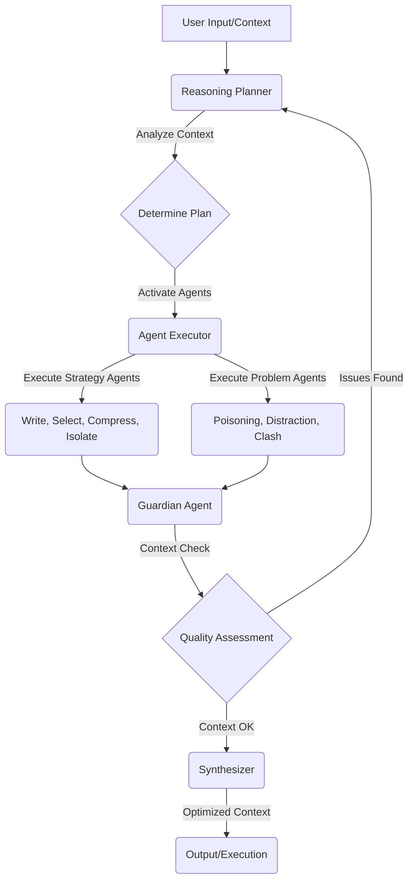

## **Generative AI Agents for Context Engineering Analysis**
This project implements a multi-agent system using LangGraph to analyze and provide recommendations for improving AI agent performance based on the principles of Context Engineering. It leverages a "plan-and-execute" architecture where a master planner agent delegates tasks to a team of specialized agents, each focusing on one of the four pillars of context engineering as described in the LangChain blog post at: https://blog.langchain.com/context-engineering-for-agents 

## 🏛️ Architecture
The architecture leverages a hybrid approach, combining dynamic agent activation with iterative refinement. A central Reasoning Planner analyzes the input context and dynamically orchestrates specialized agents. These agents are categorized into Strategy Agents (proactive optimization) and Problem Agents (reactive issue detection). A Guardian Agent continuously monitors context quality. The workflow is managed using a stateful LangGraph architecture.

### Agents with their responsibilities ###

| Agent              | Category         | Context Focus  | Responsibilities                                                                                                                                   |
|--------------------|------------------|----------------|----------------------------------------------------------------------------------------------------------------------------------------------------|
| Reasoning Planner  | Orchestrator     | All            | Analyzes context, determines which agents to activate, manages the execution plan, and integrates recommendations.                                 |
| Write Agent        | Strategy         | Write          | Optimizes instructions, prompts, and tool descriptions for clarity and effectiveness. Manages the scratchpad (working memory).                     |
| Select Agent       | Strategy         | Select         | Ensures relevant knowledge and memories are retrieved without overwhelming the context. Validates information relevance.                           |
| Compress Agent     | Strategy         | Compress       | Assesses context length and recommends summarization techniques, ensuring essential information is retained.                                       |
| Isolate Agent      | Strategy         | Isolate        | Recommends strategies for isolating context through sub-agents or state partitioning to prevent overload and contamination.                        |
| Poisoning Detector | Problem          | Poisoning      | Scans for hallucinations, inaccuracies, or manipulated information. Recommends validation and filtering.                                           |
| Distraction Filter | Problem          | Distraction    | Identifies irrelevant information that might distract the LLM and recommends pruning techniques.                                                   |
| Clash Detector     | Problem          | Clash          | Identifies contradictory information and proposes conflict resolution methods.                                                                     |
| Guardian Agent     | Quality Control  | All            | Continuously monitors the context for quality issues, integrating findings from Problem Agents and ensuring overall integrity.                     |

### Architecture Diagram ###

### Example Test Prompt ###

Your goal is to generate sophisticated and diverse web search queries. These queries are intended for an advanced automated web research tool capable of analyzing complex results, following links, and synthesizing information.

Instructions:
- Always prefer a single search query, only add another query if the original question requests multiple aspects or elements and one query is not enough.
- Each query should focus on one specific aspect of the original question.
- Don't produce more than {number_queries} queries.
- Queries should be diverse, if the topic is broad, generate more than 1 query.
- Don't generate multiple similar queries, 1 is enough.
- Query should ensure that the most current information is gathered. The current date is {current_date}.

Format: 
- Format your response as a JSON object with ALL two of these exact keys:
   - "rationale": Brief explanation of why these queries are relevant
   - "query": A list of search queries